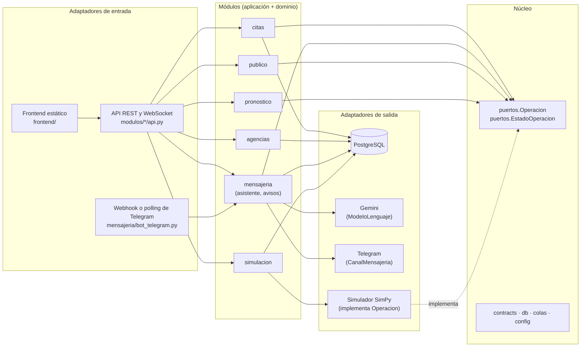

# Arquitectura de Fluport: monolito modular hexagonal

Fluport es **un solo proceso** (FastAPI) dividido en **módulos de negocio con límites estrictos**. Cada módulo
expone un servicio y define **puertos** (interfaces) para lo que necesita del exterior; los **adaptadores**
implementan esos puertos con una tecnología concreta (PostgreSQL, Telegram, Gemini, el simulador). Solo la
**raíz de composición** (`app/main.py`) decide qué adaptador implementa cada puerto.

Así, sustituir la simulación por los sensores reales de las casetas, Telegram por otro canal o Gemini por otro
modelo es escribir un adaptador nuevo, sin tocar las reglas de negocio. Y cuando un módulo necesite escalar por
separado (por ejemplo, la mensajería o el pronóstico), ya tiene una frontera limpia para extraerlo como servicio.



## Estructura

```
backend/app/
├── main.py                     raíz de composición: conecta puertos con adaptadores y arma la app
├── nucleo/                     núcleo compartido (no depende de ningún módulo)
│   ├── config.py               configuración (FLUPORT_*) y RAIZ_BACKEND
│   ├── colas.py                fórmulas de filas: FRANJA_MIN, capacidad_franja, espera_de_fila
│   ├── puertos.py              Operacion y EstadoOperacion: lo que el negocio necesita de la operación del puerto
│   ├── dependencias.py         operacion() y publicar() para los adaptadores de entrada
│   ├── contracts/              enums y schemas (contrato de la API)
│   └── db/                     motor SQLAlchemy y modelos (tablas)
└── modulos/
    ├── simulacion/             la operación simulada (adaptador del puerto Operacion)
    │   ├── dominio/            escenario, demanda, planificador, mundo, motor (Simulador)
    │   ├── adaptadores/        persistencia_pg.py (lecturas, eventos, pronósticos)
    │   ├── servicio.py         bucle en vivo; expone Ganchos que main conecta con los demás módulos
    │   ├── historico.py        comando: genera días simulados
    │   ├── api.py · api_accesos.py
    ├── pronostico/             modelo de espera a 12 h
    │   ├── dominio/features.py variables del modelo
    │   ├── pronosticador.py    servicio: pronóstico vigente, caché, entrenar_y_cargar()
    │   ├── entrenar.py · api.py
    ├── citas/                  sugerir, agendar, reprogramar, cancelar; ganchos con la operación
    │   ├── servicio.py · api.py
    ├── agencias/               catálogo, alta de transportistas y solicitudes desde el bot
    │   ├── servicio.py · api.py
    ├── mensajeria/             asistente, bot, avisos
    │   ├── puertos.py          ModeloLenguaje, CanalMensajeria
    │   ├── adaptadores/        gemini.py, telegram.py
    │   ├── dominio/avisos.py   reglas de los avisos (turno, saturación)
    │   ├── asistente/agente.py herramientas y redacción del asistente
    │   ├── servicio.py · bot_telegram.py · api.py
    └── publico/                vista pública (contingencia por entrada)
        ├── servicio.py · api.py
```

## Reglas de dependencia (las verifica `backend/tests/test_arquitectura.py`)

1. **El núcleo no depende de ningún módulo** (los tipos del simulador en `puertos.py` solo se importan para el
   verificador de tipos).
2. **El dominio no depende de infraestructura:** nada de FastAPI, SQLAlchemy, httpx ni la base de datos en `dominio/`.
3. **Un módulo solo usa de otro su `servicio` o sus `puertos`**, nunca su dominio, adaptadores ni API.
   Excepción documentada: el entrenamiento del pronóstico usa la simulación como fuente de datos históricos.
4. **Los consumidores dependen del puerto `Operacion`, no del simulador:** citas, mensajería, vista pública,
   pronóstico y agencias no importan `simulacion.dominio.motor`.
5. **La simulación no conoce a los demás módulos:** sus `Ganchos` (reinyectar y sincronizar citas, ciclo de avisos,
   guardar y entrenar el pronóstico) los conecta `main.py`.

## Cómo evoluciona hacia producción

| Necesidad | Cambio | Qué no cambia |
|---|---|---|
| Datos reales de las casetas | Un adaptador de `Operacion` sobre sensores, cámaras de placas o el sistema de la terminal | Citas, avisos, vista pública, pronóstico |
| Otro canal de mensajería (p. ej. SMS) | Un adaptador de `CanalMensajeria` registrado en `mensajeria/servicio.CANALES` | Asistente, avisos, bot |
| Otro modelo de lenguaje | Un adaptador de `ModeloLenguaje` | Herramientas y reglas del asistente |
| Escalar la mensajería o el pronóstico | Extraer el módulo como servicio; los `Ganchos` pasan a publicar eventos en un broker | El resto del monolito |
| Mucho tráfico en la vista pública | Caché o CDN delante de `/api/publico/zonas` (lecturas separadas de escrituras) | Los módulos |
